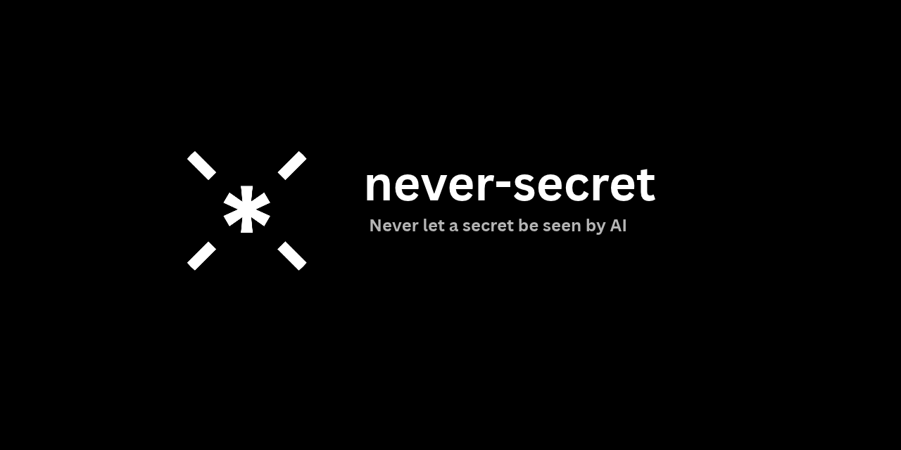

#  never-secret

Redacts secret values from every tool result before the model sees them. Works with Claude Code, Codex, Gemini CLI, OpenCode and Pi.

```bash
$ cat .env
DATABASE_URL=[REDACTED length=47]
STRIPE_SECRET_KEY=[REDACTED length=32]
OPENAI_API_KEY=[REDACTED length=32]
GITHUB_TOKEN=[REDACTED length=40]
SENTRY_DSN=[EMPTY]

$ cat config.py
DEBUG = True
AWS_REGION = "eu-west-1"
AWS_SECRET_ACCESS_KEY = "[REDACTED length=38]"
SLACK_WEBHOOK = "[REDACTED length=77]"
```

It covers file reads, shell output, search, web fetches and MCP tools. Values in known secret files (`.env`, private keys, credential files) are always hidden; everything else is scanned for secret patterns.

## Install

**Claude Code**

```
/plugin marketplace add bileet/never-secret

/plugin install never-secret@never-secret
```

**Codex**

```bash
codex plugin marketplace add bileet/never-secret

codex plugin add never-secret@never-secret
```

Then run `/hooks` in Codex and trust the never-secret hook.

**Gemini CLI**

```bash
gemini extensions install https://github.com/bileet/never-secret
```

**OpenCode**

```bash
opencode plugin add never-secret@git+https://github.com/bileet/never-secret.git
```

Then restart OpenCode (2.x). The command adds the plugin to your global `opencode.json`; to install it for a single project instead, add that same string to `plugins` in the project's `opencode.json`.

**Pi**

```bash
pi install git:github.com/bileet/never-secret
```

The package loads the extension and the `never-secret-check` skill. Remove it with `pi remove git:github.com/bileet/never-secret`.

## Verify the install

Every supported agent loads the `never-secret-check` skill with the plugin. Restart the agent, open any project and ask it to `check never-secret` (in Claude Code you can also run `/never-secret:never-secret-check`).

The skill writes random dummy secrets into `tmp/` in the project, reads them with the file-read tool, `cat`, `xxd` and `rev`, deletes them, then reports:

```
never-secret check: PASS
             read    cat     hex     rev
.env         hidden  hidden  hidden  hidden
id_rsa       hidden  hidden  hidden  hidden
settings.py  hidden  hidden  hidden  hidden
```

- **PASS**: the plugin and its hook are both active.
- **The agent doesn't know the skill**: the plugin didn't load. Check the install step for your agent.
- **FAIL with every cell `VISIBLE`**: the skill loaded but the hook isn't running. In Codex, run `/hooks` and trust it. Elsewhere, make sure `uv` or Python 3.9+ is on the agent's `PATH`.
- **FAIL with only some cells `VISIBLE`**: the hook runs but missed a case. Please open an issue with the table.

## How it works

never-secret hooks into every tool call. Output passes through it first, secrets get hidden, then the model sees it.

Secrets are caught three ways:

1. **Secret files**: every value in `.env`, private keys, `.npmrc`, `.netrc`, AWS credentials, `*.tfvars` and similar.
2. **Secret patterns**: private keys, passwords in URLs, bearer and Basic auth, and API keys from AWS, GitHub, Stripe, OpenAI, Anthropic, Slack and more.
3. **Your real values**: secrets from your secret files are hidden wherever they reappear, in logs, search results, or as hex, base64, reversed or URL-encoded.

Hidden values become `[REDACTED length=N]`. Your files are never changed, and nothing leaves your machine.

Not caught: a plain password hardcoded in regular source code.

## Development

The redaction engine lives in `core/` (Python 3.9+, stdlib only). The `hooks/` adapters (Claude Code, Codex, Gemini CLI) and the `opencode/` and `pi/` plugins all call it, so a fix there applies to every agent.

```bash
python3 tests/test_redact.py               # self-check for the engine
uvx ruff check . && uvx ruff format --check .
npx prettier --no-semi --check opencode pi
```
